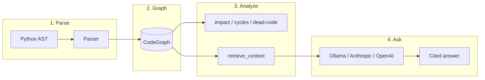

# CodeAtlas

> **Ask questions about any Python repo. Get answers with citations.**

CodeAtlas parses a Python codebase into a semantic graph, then lets you
interrogate it — via CLI commands *or* natural language. Every answer is
grounded in real `file:line` citations.

```
$ codeatlas ask "how does the parser resolve calls?"

╭─ answer ────────────────────────────────────────────────╮
│ The Parser resolves calls in three passes (codeatlas.py: │
│ 440-490). First, `_resolve_imports()` builds IMPORTS     │
│ edges from raw import statements. Then `_resolve_calls()`│
│ iterates unresolved calls, using `_resolve_one_call()`   │
│ to match each against known symbols.                     │
│                                                          │
│ The resolver tries 7 strategies in order:                │
│   1. `self.method()` → enclosing class's method          │
│   2. `self.attr.method()` → tracked attribute type       │
│   3. `x.method()` → tracked local var type               │
│   4. Bare name → same-file function                      │
│   ...                                                    │
│                                                          │
│ Citation: codeatlas.py:440                               │
╰──────────────────────────────────────────────────────────╯
```

## What it does

| Command | Purpose |
|---|---|
| `codeatlas ask "<question>"` | AI Q&A with citation-grounded answers |
| `codeatlas index` | Parse repo → semantic graph (fast, cached) |
| `codeatlas explain <symbol>` | Full symbol detail — source, callers, callees |
| `codeatlas impact <symbol>` | Transitive caller tree with hop distances |
| `codeatlas tree <symbol>` | Recursive callee tree — "what does X actually do?" |
| `codeatlas cycles` | Detect call cycles (Tarjan SCC) |
| `codeatlas dead-code` | Find uncalled functions |
| `codeatlas hotspots` | Rank by caller count |
| `codeatlas graph` | Export Mermaid dependency diagrams |
| `codeatlas callers <s>` / `callees <s>` | One-hop navigation |
| `codeatlas search <pattern>` / `list` | Explore symbols |

Every inspection command supports `--json` for scripting.

## Install

```bash
pip install -e .
```

**Optional — for `ask`:**

```bash
# Local, offline, no API keys:
winget install Ollama.Ollama   # Windows
# or: brew install ollama       # macOS
ollama pull llama3.2

# OR use an API backend:
export ANTHROPIC_API_KEY=sk-ant-...   # PowerShell: $env:ANTHROPIC_API_KEY="..."
export OPENAI_API_KEY=sk-...
```

## Quick start

```bash
# Index any Python repo
codeatlas index ./my-project

# See the stats
codeatlas stats ./my-project

# What does the main entry point call?
codeatlas tree main --path ./my-project

# If I change this, what breaks?
codeatlas impact my-project.core.Parser --path ./my-project

# Ask a question in plain English
codeatlas ask "where do we validate user input?" --path ./my-project
```

## Example — analyzing CodeAtlas itself

```bash
$ codeatlas stats .
Root:        /path/to/codeatlas
Files:       1
Symbols:     92  (7 classes, 57 functions, 28 methods)
Edges:       241 (145 calls, 0 imports, 0 inherits)
Parsed in:   108 ms

$ codeatlas hotspots --top 5
╭────┬───────────┬────────────────────────────────┬──────────────────╮
│  # │  callers  │ symbol                         │ location         │
├────┼───────────┼────────────────────────────────┼──────────────────┤
│  1 │  12 ▇▇▇▇▇ │ codeatlas.CodeGraph.callers_of │ codeatlas.py:186 │
│  2 │   9 ▇▇▇▇▇ │ codeatlas.CodeGraph.get        │ codeatlas.py:176 │
│  3 │   8 ▇▇▇▇▇ │ codeatlas._load_or_build       │ codeatlas.py:1006│
│  4 │   7 ▇▇▇▇▇ │ codeatlas._require_rich        │ codeatlas.py:832 │
│  5 │   6 ▇▇▇▇▇ │ codeatlas._err                 │ codeatlas.py:820 │
╰────┴───────────┴────────────────────────────────┴──────────────────╯

$ codeatlas cycles
╭──────────────────────────────────────╮
│ ✓ No call cycles detected.           │
╰──────────────────────────────────────╯

$ codeatlas dead-code
╭──────────────────────────────────────────────────────╮
│ ✓ No dead code detected — every internal function    │
│   is called somewhere.                               │
╰──────────────────────────────────────────────────────╯
```

## Architecture

**One file, by design.** CodeAtlas ships as a single `codeatlas.py` with
clear internal sections (Data Model → Parser → Analytics → Retrieval →
Rendering → Commands). This makes it:

- **Trivially portable** — no package structure to navigate
- **Easy to audit** — every symbol in one `grep`
- **Approachable** — new contributors don't hunt for the right module

The trade-off is intentional: cohesion over fragmentation.



**How the parser works:**

1. **Index** — discover `.py` files, build a module dotted-name map
2. **Parse** — walk each AST, emit `Symbol` nodes for modules/classes/functions/methods
3. **Resolve** — turn raw calls & imports into `CALLS` / `IMPORTS` edges using:
   - `self.method()` → enclosing class
   - `self.attr.method()` → tracked attribute type (from `self.x = Class(...)`)
   - `x.method()` → tracked local var type (from `x = Class(...)` or `x: Class`)
   - Stdlib-prefix blacklist prevents `ast.parse()` → `Parser.parse()` false matches

## Development

```bash
pip install -e ".[dev]"
pytest tests.py -v
```

## License

MIT — see [LICENSE](LICENSE).

---

**Built with** Python · Rich · no frameworks, no web server, no telemetry.